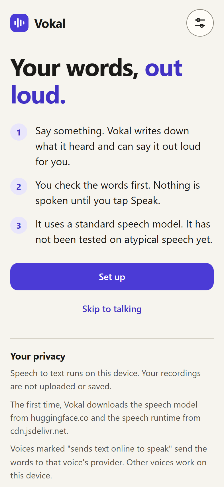
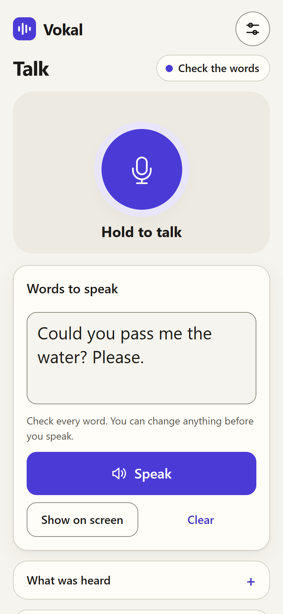
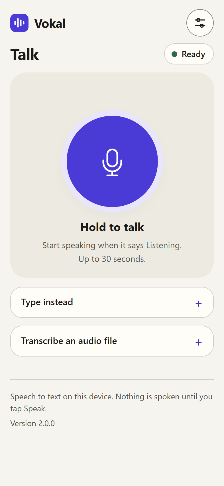
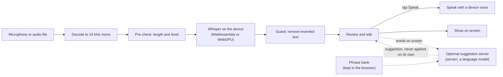

# Vokal

Vokal is a web app, being built for phones, for people whose words are intact but whose voice cannot carry them: after a laryngectomy, with a paralysed vocal cord, or as motor neurone disease (MND) weakens the voice. You hold a button and speak. Whisper writes down what you said, in the browser, on the device itself. You check the words, and Vokal says them out loud only when you tap Speak.

<p>
  
  
  
</p>

Screenshots from the browser test at phone size (393 x 852) in desktop Edge. The words came from a synthetic voice.

- v1, August 2026: an ESP32-S3 hand-held device that sent each recording to a laptop running Whisper (kept at the git tag `v1-esp32-puck`, see [History](#history)).
- v2, October 2026, this code: speech to text runs in the browser on the device, and the app works offline after one download.
- Next: making recognition work for atypical speech. I am measuring stock Whisper on the TORGO dysarthric speech corpus, then fine-tuning it ([`ml/README.md`](ml/README.md)).

Status: Vokal runs stock Whisper and has only been checked in a desktop browser with synthetic, typical speech. It has not been tried on a real phone, and it has not been tested on atypical speech.

Try it: the app is not deployed yet. Once GitHub Pages is switched on for this repository, it will be at <https://warisback.github.io/Vokal/>. Until then it runs locally with one command (see [Run it](#run-it)). The first use downloads about 70 MB once, when you tap Download: the 43.5 MB default model plus the 26.9 MB speech runtime. After that it works offline (checked in desktop Edge, not yet on a phone).

## Why

Some people know exactly what they want to say but cannot be heard: after a laryngectomy, with a paralysed vocal cord, or as motor neurone disease (MND) weakens the voice. Typing everything is slow, and general speech recognition is trained mostly on typical voices, so it often fails on quiet, breathy or dysarthric speech. A device that speaks for someone also has one rule above the rest: it must never say words the person did not say, because they may not be able to correct it out loud. Vokal is built around that rule.

## How it works



Audio never leaves the device. The first visit downloads the app, and tapping Download fetches the speech model (from huggingface.co) and the speech runtime (from cdn.jsdelivr.net); after that nothing needs the network. Only two things can send text anywhere, and both are optional and labelled in the app:

- Suggestions, when you set a server address, send the words on screen and your saved phrases for the current model to that server, which may pass them to a language model provider. The server can instead use a model running on your own computer (any OpenAI-compatible server, such as llama.cpp or Ollama, though neither has been tried yet), so the text stays there.
- A browser voice marked "sends text online to speak" sends the words to that voice's provider. Other voices work on the device.

Vokal speaks with stock voices: the device's own in the app, a stock Piper voice in Python. Nobody's voice is cloned. The reasons behind these choices, and what was rejected, are in [`docs/DECISIONS.md`](docs/DECISIONS.md).

## What works today

Checked on one Windows laptop in headless Edge, with synthetic speech from Windows System.Speech: transcribing files, hold to talk, the guard on silence, review and Speak, suggestions turning off when the server has no model, and reloading offline. Not yet driven in a browser: tap mode, typing, Show on screen, Say it again, the setup screens, and phrase export and import. Say it again and the phrase bank's storage, export and import have unit tests.

- Speech to text on the device. Whisper (`tiny.en` by default, `base.en` as an option) runs in the browser through transformers.js 4.3.0 and ONNX Runtime, on WebAssembly, or on the graphics chip through WebGPU if you choose it in Settings. Audio is not uploaded or saved.
- Hold to talk (or tap to start and tap to stop), up to 30 seconds. You can also type, or transcribe an audio file.
- A guard that removes text Whisper is known to invent ([below](#the-guard)).
- Review before speaking. The words land in an editable box and nothing is spoken until you tap Speak. Show on screen displays them full size, for a noisy room or when speech fails, and Say it again repeats the last spoken line.
- A phrase bank. During setup you record a few phrases and confirm the words you meant. Each entry records which model heard it and how it was recorded, so later experiments compare like with like. Phrases stay in the browser and can be exported and imported as JSON. The setup screens have not been run in a browser yet.
- Optional suggestions. A small Node server (`server/`) can ask a language model whether the words on screen contain a recognition mistake that matches one of your saved phrases. A suggestion is shown beside your words and never applied or spoken on its own. The server refuses any suggestion that adds or removes a negation, changes a number, or changes more than 30% of the words. This part is tested with fake providers only; no live model call has been made with this version.
- Offline use after the first download. A service worker keeps the app and the browser cache keeps the model. Checked by stopping the server, cutting the network, reloading and transcribing a file.
- A Python package (`python/`) with the same Whisper settings and guard. It is the seam for the ML work: evaluation code can import it, and `--model` takes a fine-tuned model converted to CTranslate2 (not tried yet). So far it has only run on Windows.

### Measured speed

Measured with the app's own browser test (`npm run e2e -- --base-en --webgpu`, run from `app/`) on 15 October 2026, on one laptop on mains power: Intel Core i5-12450H (12 logical cores), 40 GB RAM, Windows 11, headless Edge 155, transformers.js 4.3.0. WebAssembly ran on one thread. WebGPU ran on the integrated Intel UHD graphics; the laptop's RTX 3050 laptop GPU (4 GB) was not used by the browser. The input was synthetic speech.

| Model and backend | Download, once | Second visit, page open to Ready | 3.16 s sentence | 6.98 s sentence |
|---|---|---|---|---|
| `tiny.en` q8, WebAssembly (default) | 43.5 MB | 2.2 s | 3.1 to 3.9 s | 3.9 to 4.1 s |
| `base.en` q8, WebAssembly | 79.6 MB | 2.5 s | 6.4 to 7.2 s | 7.8 to 8.1 s |
| `tiny.en` fp32 encoder, q4 decoder, WebGPU | 122.3 MB | 2.6 s | 1.8 to 1.9 s | 2.7 to 2.8 s |

Each transcription time is the speech worker's own figure, three runs on the second visit. Download sizes leave out the 26.9 MB runtime. The first call after the WebGPU download took 5.6 s. With hold to talk, the status changed to Listening 82 ms after the press (fake microphone).

- Nothing has been timed on a phone yet. Earlier runs on the same laptop gave different numbers, including a minimal test page where WebGPU was no faster than WebAssembly; they are in [decision 7](docs/DECISIONS.md#7-webassembly-by-default-webgpu-only-when-chosen). WebAssembly stays the default because it downloads far less, until phones are measured.
- On these clean synthetic sentences every model returned the right words, apart from punctuation. That is the easiest possible input: it shows the pipeline works, not that recognition works for the people Vokal is for.
- The Python package, on the same laptop with `tiny.en` on the CPU (int8), transcribed a 5.36 s synthetic sentence in about 0.55 s once the model was loaded (two runs).

### The guard

Whisper sometimes writes words nobody said, mostly on silence and noise. The first version of Vokal ran into this on real recordings:

- Whisper added "Thank you." on the silence at the end of a clip. Online video subtitles often end that way, which is probably where the model learned it.
- A prompt meant to help with quiet speech ("A person speaking softly in a quiet voice.") came back as part of the transcript, and about 30 s of real speech went missing in the same run. Vokal never passes a prompt to Whisper.
- On one clip it heard "help" as "hell" and added a sentence nobody said. No filter can catch that kind of mistake, which is why the person reviews every line.

In this version, every model tried on the laptop turned 3 s of digital silence into "you".

So before anything is shown, the guard:

- skips the model when a recording is too short, silent or too quiet;
- drops the whole result when Whisper's own no-speech score is above 0.6;
- removes sound tags such as `[Music]`, subtitle credit lines, and stock filler such as "Thank you." at the very end.

It only ever removes. Each removal is listed under "What was heard" with its reason, and one tap puts it back, because a real "Thank you" is a common thing to say. Nothing fills a gap with plausible words: answering an empty result with "Sorry, could you repeat that?" was rejected for that reason. The app (JavaScript) and the Python package implement the same rules and pass the same 100 cases in [`shared/guard_cases.json`](shared/guard_cases.json), and [a test](python/tests/test_guard_parity.py) runs both on 30,000 seeded random strings and checks that they agree.

## Roadmap

The next stage is the speech model itself. The plan, the evaluation rules and the places where a trained model plugs in are in [`ml/README.md`](ml/README.md).

| Step | Status | Why it matters |
|---|---|---|
| 1. Baseline Whisper on the TORGO dysarthric speech corpus: word error rate per speaker and per severity | In progress, started 10 October 2026 | Gives every later change a number to beat, and checks whether the guard's 0.6 cut-off drops real dysarthric speech. |
| 2. Speaker-disjoint and sentence-disjoint splits | Planned | TORGO speakers read the same prompts, so a random split of clips puts the same sentence in training and test and flatters the result. |
| 3. Fine-tune Whisper-small with LoRA on one speaker, tested on held-out sentences | Planned | Tests whether a small amount of one person's speech makes a real difference. |
| 4. Repair with a language model and the person's own phrase bank | Planned | A language model may fix a misheard word or invent one. The test is how often each happens. |
| 5. Shrink it for the phone: model size, quantisation, runtimes (whisper.cpp, ONNX, WebGPU) | Planned | Accuracy has to survive the trip to a phone, so latency and memory get measured on a real iPhone and Android phone ([checklist](docs/PHONE_CHECKLIST.md)). |
| 6. Release the fine-tuned model as a choice in Settings, with a public write-up of per-speaker results | Planned | A public, per-speaker account of what helped and what did not. |
| Continued pre-training on untranscribed speech | Research, only if fine-tuning plateaus | Untranscribed atypical speech is easier to collect than labelled speech. |
| Voice banking | Later | Someone who expects to lose their voice could record it while they can, and Vokal could speak in it. Not built. |

## Run it

You need Node 22.9 or later for the app server and tests, and Python 3.10 or later for the Python package (only 3.12 has been tried).

### The app

There is no build step. Browsers only allow the microphone on HTTPS pages or on `localhost`, so serve `app/` locally or over HTTPS. Fetch the pinned speech library once (it is not committed), then start the included server, which has no dependencies:

```
npm run vendor --prefix app
node server/server.mjs
```

Then open <http://127.0.0.1:3210/>. Add `--base /Vokal/` to serve it under the same sub-path as GitHub Pages.

- Suggestions: copy `server/.env.example` to `server/.env`, choose a provider and add its key, run `npm start --prefix server`, then set the server address in the app's Settings to `./` (the server that is serving the page).
- On a phone: the GitHub Pages build is the intended route once it is deployed. Nothing has been tried on a phone yet ([checklist](docs/PHONE_CHECKLIST.md)). An HTTPS tunnel to your own server should also work but has not been tried. It publishes the suggestion endpoint to the internet; read [the tunnel section](server/README.md#using-it-from-a-phone-through-a-tunnel) and set `VOKAL_ACCESS_TOKEN` first.
- Your own model: in Settings, Custom model, enter a public Hugging Face repo as `owner/name@revision`, or `models/<name>` for a folder served by `node server/server.mjs --models <folder>`. Not tried end to end yet; see [`ml/README.md`](ml/README.md#where-a-trained-model-plugs-in).

### The Python package

Make the virtual environment outside OneDrive and away from long paths (OneDrive corrupts `site-packages`, and deep paths break the numpy install on Windows). From the repository root:

```
py -3.12 -m venv C:\venvs\vokal
C:\venvs\vokal\Scripts\activate
pip install -e "python[all,dev]"
vokal transcribe clip.wav --model tiny.en
vokal say clip.wav --voice-dir C:\piper-voices --out reply.wav
```

`--model` also takes a folder with a fine-tuned model converted to CTranslate2. No fine-tuned model has been loaded this way yet. More in [`python/README.md`](python/README.md).

### Tests

```
npm run vendor --prefix app
npm test --prefix app
npm test --prefix server
pytest python/tests
```

Apart from the one-time `npm run vendor`, none of these needs the network or a sound card, and only pytest needs an install (`pip install -e "python[dev]"`). The guard parity test runs the app's JavaScript guard with Node, and is skipped when Node is not on the path.

The browser test, `app/tests/e2e.mjs`, drives headless Edge with a fake microphone and synthetic speech. It needs `npm install --prefix app` once, then `npm run e2e --prefix app`. Each run uses a fresh browser profile, so it downloads the model and runtime (about 70 MB) every time; `--base-en` adds 79.6 MB and `--webgpu` 122.3 MB. It is written for Windows: it uses Edge (`VOKAL_E2E_CHANNEL=chrome` for Chrome) and makes its longer sentence with System.Speech (elsewhere, pass `--long <wav>`).

GitHub Actions ([`test.yml`](.github/workflows/test.yml)) runs a hygiene check (no recordings, `.env` files, secrets or model weights in the repo) and all three suites on every push to `main` and every pull request. [`pages.yml`](.github/workflows/pages.yml) deploys `app/` to GitHub Pages once Pages is switched on for the repository; the steps are in the workflow file.

## Repository layout

| Path | What it is |
|---|---|
| `app/` | The web app. Plain ES modules, no build step. transformers.js 4.3.0 is fetched into `app/vendor/` by `npm run vendor --prefix app`, which checks its SHA-256. |
| `app/js/app.js` | Screens, the talk flow, review and the settings dialog. |
| `app/js/asr-worker.js` | Whisper in a Web Worker (transformers.js), with the no-speech score. |
| `app/js/asr.js` | The page's side of the worker: one request at a time, in order. |
| `app/js/audio.js` | Recording, the level meter and decoding to 16 kHz mono. |
| `app/js/guard.js` | The guard. |
| `app/js/models.js` | Model ids, pinned revisions and the custom model setting. |
| `app/js/correct.js` | Calls to the optional suggestion server. |
| `app/js/settings.js` | Settings and the phrase bank, kept in the browser. |
| `app/js/onboarding.js` | The setup screens. |
| `app/tests/` | Unit tests (Node's built-in test runner), the browser test and one synthetic audio fixture. |
| `server/` | Optional Node server with no dependencies: serves the app and local model folders, and offers suggestions. |
| `python/` | Python package and command line tool: faster-whisper, the guard and Piper. |
| `shared/guard_cases.json` | The cases both guards must pass. |
| `ml/` | The ML plan, the evaluation rules and how a trained model plugs in. No code yet. |
| `docs/` | Decisions, the phone checklist and the screenshots. |
| `.github/workflows/` | Tests on every push to `main`, and the GitHub Pages deploy. |

Two languages, on purpose: the browser app and the server are plain JavaScript with no dependencies, while the ML tooling (faster-whisper, CTranslate2 and the evaluation to come) is Python.

## History

Vokal started in August 2026 as a hand-held device built on a Waveshare ESP32-S3-Touch-AMOLED-1.8 board, with a microphone, a speaker and a touch screen. You pressed record, spoke and pressed stop. The board captured 16 kHz mono audio on one core while the screen ran on the other, and served each recording over its own Wi-Fi access point. A laptop pulled the recording, transcribed it with faster-whisper (`small.en`, int8 on the CPU), ran the first version of the guard, spoke the result with a local Piper voice and sent the caption back to the screen. The board firmware (first written as a meeting recorder) and its first host client are by [@stosifian](https://github.com/stosifian); I wrote the laptop speech pipeline and the loop that joined the two.

The aim was about 2 s from the end of speech to sound. Each part was timed on its own, but the whole loop never was, so there is no end-to-end figure to quote.

That version is kept at the git tag `v1-esp32-puck`. The board lessons worth keeping are at the end of [`docs/DECISIONS.md`](docs/DECISIONS.md#v1-hardware-lessons).

In September 2026 a first phone version, made at a Google DeepMind Gemma event, sent each recording to Gemini and used Gemma to correct it. v2 replaced that with Whisper on the device, and kept the language model as an optional suggestion. Vokal moved to the phone because the puck needed a laptop nearby to do the work, while a phone already has a microphone, a speaker and a screen, the person already carries it, and small Whisper models now run inside a web browser.

## Licence

MIT, see [`LICENSE`](LICENSE). transformers.js, fetched into `app/vendor/`, is Apache-2.0, see [`app/vendor/LICENSE`](app/vendor/LICENSE).
